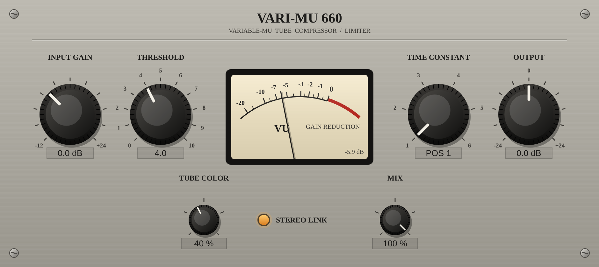

# VariMu 660

*English · [Norsk](README.no.md)*


A simple variable-mu compressor in VST3 format (and AU on Mac), inspired by the Fairchild 660/670. Built with JUCE 9.0.5.

If you like this app and want to support me:

<a href="https://www.buymeacoffee.com/trondmorsej" target="_blank"></a>



## Controls

| Control | What it does |
|---|---|
| **Input Gain** (−12 to +24 dB) | How hard the signal drives the compressor and the tube. As on the original: more input = more compression and more colour. |
| **Threshold** (0–10) | Threshold. Higher number = lower threshold = more compression (from about −4 to −36 dBFS). |
| **Time Constant** (1–6) | The six classic attack/release combinations (see below). |
| **Output** (−24 to +24 dB) | Output level/makeup. |
| **Tube Color** (0–100 %) | Amount of tube and transformer saturation, mostly 2nd harmonic. 0 % = clean compression, 40 % = warm colour, 100 % = clear saturation. |
| **Mix** | Parallel compression (dry/wet, latency compensated). |
| **Stereo Link** | Shared gain reduction for left/right (no stereo image wandering). Off = dual mono. |

### Time Constant

| Pos | Attack | Release |
|---|---|---|
| 1 | 0.2 ms | 0.3 s |
| 2 | 0.2 ms | 0.8 s |
| 3 | 0.4 ms | 2 s |
| 4 | 0.4 ms | 5 s |
| 5 | 0.4 ms | Auto: about 2 s for single peaks, up to 10 s with sustained compression |
| 6 | 0.2 ms | Auto: about 0.3 s for single peaks, 10 s for multiple peaks, up to 25 s with sustained compression |

Typical use: 1–2 on drums and bass, 3 on vocals, 4–6 on buses and mastering (low gain reduction, 1–3 dB).

## How the model works

- **Feedback topology**: the sidechain reads the output of the gain reduction stage, as in the original.
- **Progressive ratio**: about 2:1 just above the threshold, gradually rising towards ~20:1 the harder you drive it, with a soft knee (12 dB). This is the hallmark of the variable-mu tube.
- **Auto release (5 and 6)**: modelled as an RC network with several capacitors. The slow capacitors only charge when the compressor works over time, so single peaks are released quickly while sustained compression is released slowly.
- **Tube colour**: asymmetric saturation (mostly 2nd harmonic) where the distortion increases with gain reduction, plus soft transformer saturation in the bass.
- **2x oversampling** (linear phase) on the whole compressor to avoid aliasing. The latency (about 1 ms) is reported to the DAW.

## Code structure

| File | Contents |
|---|---|
| `Source/VariMuCompressor.h` | The compressor itself and the tube colour. Plain C++ without JUCE, so it can be tested on its own. |
| `Source/PluginProcessor.*` | Parameters, input/output gain (smoothed), oversampling, dry/wet and bypass. |
| `Source/PluginEditor.*` | GUI: knobs, VU meter and the Fairchild panel. |
| `Tests/` | DSP test, VST3 test host and GUI screenshot. |

The code follows common VST3/JUCE practice:

- No memory allocation, locks or file I/O on the audio thread. Everything is set up in `prepareToPlay`.
- Input and output gain are smoothed over 50 ms, so automation does not crackle.
- The latency is fixed and reported to the host. Bypass delays the audio by the same amount, so it does not jump in time.
- Empty audio blocks and varying block sizes are handled.

## License

JUCE is dual-licensed under AGPLv3 and a commercial JUCE license. For private use this is not a problem. If the plugin is shared as closed source or sold, you may need a commercial license. See the [JUCE license](https://juce.com/legal/juce-9-licence/).

## Installing

Download `VariMu660-macOS.pkg` under **Releases** (or from the latest build under **Actions**) and double-click it. The installer puts:

- `VariMu 660.vst3` in `/Library/Audio/Plug-Ins/VST3/`
- `VariMu 660.component` (AU, for Logic) in `/Library/Audio/Plug-Ins/Components/`

The installer is not signed with an Apple developer certificate. If macOS says it cannot be opened: right-click the file and choose **Open**, or go to **System Settings → Privacy & Security** and click **Open Anyway**.

## Building on Mac

You need Xcode (from the App Store) and CMake (`brew install cmake`).

```bash
cd VariMu660
cmake -B build -G Xcode
cmake --build build --config Release
```

JUCE is downloaded automatically the first time (takes a couple of minutes). The result ends up in:

- `build/VariMu660_artefacts/Release/VST3/VariMu 660.vst3`
- `build/VariMu660_artefacts/Release/AU/VariMu 660.component`
- `build/VariMu660_artefacts/Release/Standalone/VariMu 660.app` (for quick testing without a DAW)

Install by copying to:

```bash
cp -R "build/VariMu660_artefacts/Release/VST3/VariMu 660.vst3" ~/Library/Audio/Plug-Ins/VST3/
cp -R "build/VariMu660_artefacts/Release/AU/VariMu 660.component" ~/Library/Audio/Plug-Ins/Components/
```

The plugin is not signed, so if macOS blocks it:

```bash
xattr -dr com.apple.quarantine ~/Library/Audio/Plug-Ins/VST3/"VariMu 660.vst3"
```

A universal binary (Apple Silicon + Intel) is built automatically.

### Building via GitHub

The workflow in `.github/workflows/build-macos.yml` runs on every push: it builds VST3 + AU, runs the DSP test and pluginval, and creates a `.pkg` and a zip under *Actions → latest run → Artifacts*. When `VERSION` in `CMakeLists.txt` is increased (e.g. to 1.0.1), the build also creates a new release with the files.

## Tests

```bash
cmake -B build -DVARIMU_BUILD_TESTS=ON
cmake --build build --target DspTest && ./build/DspTest
```

`DspTest` measures the static compression curve, release times for all six positions and harmonic content. Running [pluginval](https://github.com/Tracktion/pluginval) on the Mac as well is a good idea.
